<a href="https://k0t3i.github.io/">
  <picture>
    <source media="(prefers-reduced-motion: reduce) and (prefers-color-scheme: dark)" srcset="https://raw.githubusercontent.com/k0t3i/k0t3i/main/assets/banner-dark-still.svg">
    <source media="(prefers-reduced-motion: reduce)" srcset="https://raw.githubusercontent.com/k0t3i/k0t3i/main/assets/banner-light-still.svg">
    <source media="(prefers-color-scheme: dark)" srcset="https://raw.githubusercontent.com/k0t3i/k0t3i/main/assets/banner-dark.svg">
    
  </picture>
</a>

# Anthony — Principal front-end engineer

**Front-end, no shortcuts.** Building interfaces since 2004, and circuits for even longer.

`Vue 3` · `a11y AA` · `INTJ-A` · `LH 100` · `AI` · `n8n`

## Projects

- **[Kit d’urgence](https://k0t3i.github.io/kit-urgence/)** — A 3D simulator that plans the emergency kit for your home: adults, children, from 72 hours to 3 weeks. In French.
- **[SplitR](https://github.com/k0t3i/splitr-releases/releases/latest)** — A desktop app (Windows, macOS) to split, process and export media files.
- **[MyCard](https://my-card.tisserands.ai/)** — SaaS platform for digital business cards, with a live editor and QR-code sharing.
- **[MonScoreImmo](https://monscoreimmo.fr/)** — SaaS that scores the online presence of real-estate agents. Launching soon.

## Contact

[contact@tisserands.ai](mailto:contact@tisserands.ai) · [k0t3i.github.io](https://k0t3i.github.io/)

<picture>
  <source media="(prefers-reduced-motion: reduce) and (prefers-color-scheme: dark)" srcset="https://raw.githubusercontent.com/k0t3i/k0t3i/output/routage-dark-still.svg">
  <source media="(prefers-reduced-motion: reduce)" srcset="https://raw.githubusercontent.com/k0t3i/k0t3i/output/routage-light-still.svg">
  <source media="(prefers-color-scheme: dark)" srcset="https://raw.githubusercontent.com/k0t3i/k0t3i/output/routage-dark.svg">
  
</picture>
<picture>
  <source media="(prefers-color-scheme: dark)" srcset="https://raw.githubusercontent.com/k0t3i/k0t3i/output/uptime-dark.svg">
  
</picture>
